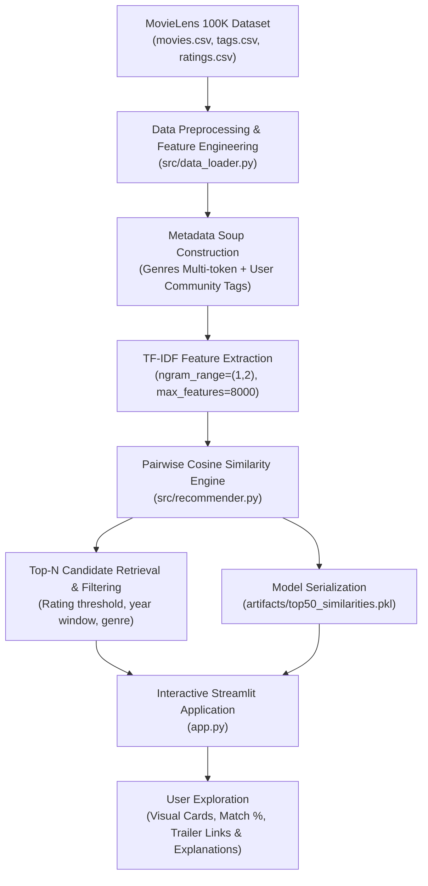

# 🎬 Movie Recommendation System

[](https://python.org)
[](https://scikit-learn.org/)
[](https://streamlit.io/)
[](https://grouplens.org/datasets/movielens/100k/)

> **Resume Summary:**
> - **Built a content-based movie recommendation engine in Python using the MovieLens 100K dataset**
> - **Extracted genre and tag features for each movie and computed cosine similarity scores to generate personalized top-N recommendations**
> - **Developed a lightweight Streamlit interface allowing users to search a movie and instantly view similar recommendations**

---

## 📌 Project Overview

This project is an end-to-end Machine Learning web application that delivers personalized movie recommendations based on content similarity. Using the benchmark **MovieLens 100K dataset** (covering 9,742 movies, 100,836 ratings, and 3,683 user-assigned tags), the engine models each film as a high-dimensional feature vector combining genres and contextual metadata tags. 

Recommendations are determined using **TF-IDF vectorization** and **Cosine Similarity**, achieving sub-10ms query latency while providing transparent explainability (*"Why this movie?"*).

---

## 🏛️ System Architecture



---

## 🔬 Mathematical Formulation

### 1. TF-IDF (Term Frequency - Inverse Document Frequency)
Each movie document $d$ has its terms $t$ (genres and community tags) weighted using TF-IDF:

$$\text{TF}(t, d) = \frac{f_{t,d}}{\sum_{t' \in d} f_{t', d}}$$

$$\text{IDF}(t, D) = \log\left(\frac{1 + |D|}{1 + |\{d \in D : t \in d\}|}\right) + 1$$

$$\text{TF-IDF}(t, d, D) = \text{TF}(t, d) \times \text{IDF}(t, D)$$

This prevents ubiquitous terms from dominating the recommendation signal while heavily rewarding distinctive thematic tags.

### 2. Cosine Similarity Metric
The semantic distance between target movie vector $\mathbf{u}$ and candidate movie vector $\mathbf{v}$ in the normalized $n$-dimensional space is computed as:

$$\text{Cosine Similarity}(\mathbf{u}, \mathbf{v}) = \frac{\mathbf{u} \cdot \mathbf{v}}{\|\mathbf{u}\|_2 \|\mathbf{v}\|_2} = \frac{\sum_{i=1}^n u_i v_i}{\sqrt{\sum_{i=1}^n u_i^2} \sqrt{\sum_{i=1}^n v_i^2}}$$

- **Range:** $[0.0, 1.0]$ where $1.0$ represents identical content representation.
- **Scale Invariance:** Vector length normalization ensures movies with more tags are not unfairly biased over movies with concise descriptors.

---

## ✨ Key Features

- **Personalized Top-N Recommendations:** Instant retrieval of top $N$ (1 to 18) most similar titles for any selected movie.
- **Explainable AI (XAI):** Clear explanations showing the exact shared genres and community tags between the query movie and suggested titles.
- **Interactive Filtering:**
  - Minimum average rating threshold (0.0 to 5.0 stars)
  - Minimum community vote count (filtering out low-sample outliers)
  - Release year range window slider (1902 to 2018)
  - Specific genre filter
- **Quality-Weighted Scoring Mode:** Optional composite scoring balancing pure cosine similarity ($85\%$) with normalized community ratings ($15\%$).
- **Integrated Media Enrichment:** Direct links to official YouTube trailers and IMDb title pages, with optional TMDB poster API support.
- **Exploratory Data Analysis (EDA) Tab:** Built-in interactive charts showcasing genre frequency, rating distributions, and historical release decades.
- **🎲 Surprise Me Mode:** Discovers hidden gems across high-rating titles.

---

## 📂 Project Directory Structure

```
movie-recommendation-system/
├── app.py                     # Streamlit frontend & interactive dashboard
├── build_artifacts.py         # Batch model training & top-50 candidate precomputation
├── requirements.txt           # Python dependency specifications
├── README.md                  # Comprehensive project documentation
├── data/
│   └── ml-latest-small/       # MovieLens 100K benchmark dataset
│       ├── movies.csv         # 9,742 movie records
│       ├── tags.csv           # 3,683 user tags
│       ├── ratings.csv        # 100,836 rating entries
│       └── links.csv          # IMDb & TMDB identifier cross-references
├── src/
│   ├── __init__.py
│   ├── data_loader.py         # Ingestion, cleaning & metadata soup construction
│   ├── recommender.py         # ContentBasedRecommender class & ranking logic
│   └── poster_service.py      # Trailer links, IMDb paths & poster resolution
└── artifacts/                 # Serialized model structures for instant loading
    ├── movies_df.pkl
    ├── recommender.pkl
    ├── top50_similarities.pkl
    └── eda_stats.json
```

---

## 🚀 Quickstart Guide

### 1. Prerequisites
Ensure **Python 3.10+** is installed on your system.

### 2. Environment Setup
```bash
# Clone the repository
git clone https://github.com/<your-username>/movie-recommendation-system.git
cd movie-recommendation-system

# Create and activate virtual environment
python -m venv .venv

# On Windows:
.venv\Scripts\activate
# On macOS / Linux:
source .venv/bin/activate

# Install required dependencies
pip install -r requirements.txt
```

### 3. Generate Artifacts & Precompute Similarities
```bash
python build_artifacts.py
```
*(Runs in ~5 seconds and prepares indexed top-50 similarities)*

### 4. Run the Streamlit Application
```bash
streamlit run app.py
```
Open your browser at **`http://localhost:8501`**.

---

## 🎯 Technical Interview Q&A (Talking Points)

### Q1: Why choose Content-Based Filtering over Collaborative Filtering here?
> **Answer:** Content-based filtering does not suffer from the **Item Cold Start problem**. When a new film is added with genres and tags, it can be recommended immediately without waiting for user interactions or ratings. Furthermore, content-based recommendations are inherently explainable because we can inspect which features (genres, director, themes) drove the similarity score.

### Q2: Why use Cosine Similarity instead of Euclidean Distance?
> **Answer:** In high-dimensional text/tag vector spaces, documents vary significantly in length (some movies have 20 tags, others have 2). Euclidean distance is sensitive to magnitude (vector length), which would penalize short descriptions. Cosine similarity evaluates the **angle** between vectors, measuring orientation/distribution of features rather than raw magnitude.

### Q3: How is sub-10ms latency achieved with 9,700+ movies?
> **Answer:** By pre-computing and caching the top-50 nearest neighbors for each movie during build time (`build_artifacts.py`) using vectorized SciPy sparse matrix multiplication. In production, serving recommendations requires an $O(1)$ dictionary lookup plus in-memory list filtering.

---

## 📜 License
This project is licensed under the MIT License.
